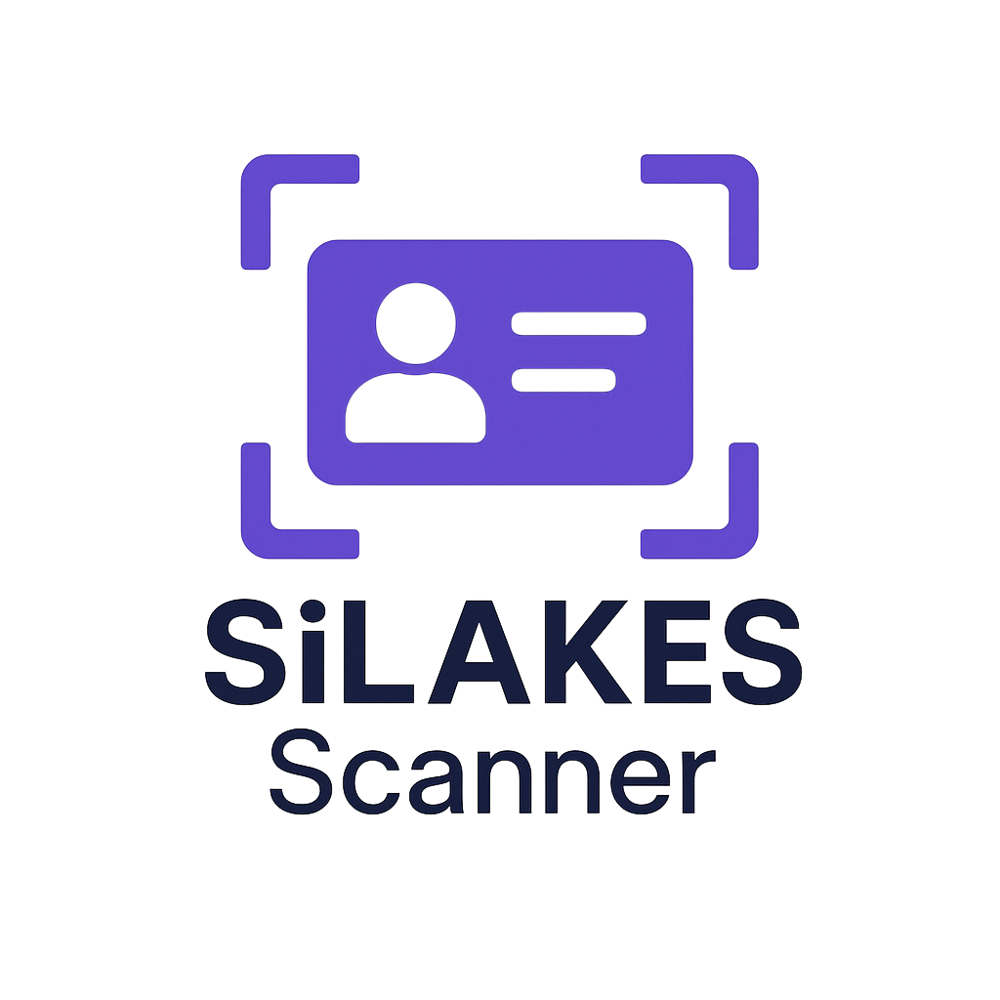

# 📱 SiLAKES Scanner

<p align="center">
  
</p>

Aplikasi Flutter untuk pemindaian KTP pasien menggunakan AI (Google Gemini Vision) dengan integrasi otomatis ke sistem SiLAKES.

## ✨ Fitur

- 🎯 **Scan KTP Otomatis** - Menggunakan AI Gemini untuk OCR
- 🔍 **Validasi NIK** - Cek otomatis ke database SiLAKES
- ✏️ **Edit & Koreksi** - Tampilan preview untuk koreksi data
- 🔥 **Firebase Sync** - Kirim data ke Firebase Realtime Database
- 💾 **Local History** - Simpan riwayat scan lokal dengan Hive
- 🔐 **Encryption** - API key terenkripsi AES-256-CBC
- 🎨 **Modern UI** - Design clean dengan tema biru muda
- 🚀 **Fast & Smooth** - Optimized performance

## 🏗️ Arsitektur

### Tech Stack
- **Flutter** 3.24.x
- **Riverpod** - State management
- **Hive** - Local database
- **Firebase** - Realtime Database
- **Google Gemini** - AI Vision OCR
- **Laravel API** - Backend integration

### Struktur Folder
```
lib/
├── core/
│   ├── config/          # App configuration
│   ├── models/          # Data models (PatientData)
│   ├── providers/       # Riverpod providers
│   ├── theme/           # App theme & styles
│   └── utils/           # Helper functions
├── services/
│   ├── config_service.dart
│   ├── gemini_service.dart
│   ├── silakes_api_service.dart
│   ├── firebase_service.dart
│   └── local_cache_service.dart
└── features/
    ├── dashboard/       # Dashboard & history
    └── scanner/         # Camera & preview screens
```

## 🚀 Getting Started

### Prerequisites

- Flutter SDK >= 3.8.1
- Dart SDK >= 3.8.0
- Android Studio / VS Code
- Firebase Account
- Laravel Backend (SiLAKES API)

### Installation

1. **Clone & Navigate**
   ```bash
   cd "D:\Project APP\silakes_scanner"
   ```

2. **Install Dependencies**
   ```bash
   flutter pub get
   ```

3. **Configure Firebase** ⚠️
   
   📄 Lihat file: **[YOUR-TASK-1-FIREBASE-CONFIG.md](YOUR-TASK-1-FIREBASE-CONFIG.md)**
   
   - Setup Firebase project
   - Download `google-services.json`
   - Copy ke `android/app/`
   - Update database URL

4. **Configure App**
   
   Edit `lib/core/config/app_config.dart`:
   
   ```dart
   // Base URL Laravel API Anda
   static const String baseUrl = 'https://api.silakes.labkesdasumenep.id/api/v1';
   
   // Shared encryption key (32 karakter, sama dengan Laravel)
   static const String flutterEncryptionKey = 'YOUR_32_CHARACTER_SHARED_KEY_HERE';
   
   // Firebase Database URL
   static const String firebaseRealtimeDatabaseUrl = 'https://YOUR-PROJECT-ID-default-rtdb.firebaseio.com';
   ```

5. **Generate Code**
   ```bash
   flutter pub run build_runner build --delete-conflicting-outputs
   ```

6. **Run App**
   ```bash
   flutter run
   ```

## 📖 Panduan Penggunaan

### 1. Dashboard
- Tampilan utama dengan tombol "Mulai Scan"
- Lihat riwayat scan sebelumnya
- Refresh API key jika diperlukan

### 2. Scan KTP
- Posisikan KTP di dalam frame guide
- Ambil foto dengan jelas
- Pastikan semua teks terbaca

### 3. Preview & Edit
- Data hasil OCR akan ditampilkan
- Koreksi jika ada yang salah
- Tap "Simpan Data" untuk submit

### 4. Hasil
- **NIK Sudah Terdaftar**: Notifikasi dan kembali ke dashboard
- **NIK Belum Terdaftar**: Data dikirim ke Firebase & tersimpan di history

## 🔧 Konfigurasi Backend

### Laravel Endpoints Required

1. **GET** `/api/v1/config/gemini-key`
   ```json
   {
     "data": {
       "api_key_encrypted": "base64_encrypted_key",
       "iv": "base64_iv"
     }
   }
   ```

2. **GET** `/api/v1/cek-nik/registered/{nik}`
   ```json
   {
     "registered": true/false,
     "data": { ... }
   }
   ```

### Firebase Structure
```
patients/
  ├── {uuid}/
  │   ├── id: string
  │   ├── nik: string
  │   ├── nama: string
  │   ├── tempat_lahir: string
  │   ├── tanggal_lahir: string
  │   ├── jenis_kelamin: string
  │   ├── alamat: string
  │   ├── rt_rw: string
  │   ├── kel_desa: string
  │   ├── kecamatan: string
  │   ├── agama: string
  │   ├── status_perkawinan: string
  │   ├── pekerjaan: string
  │   ├── kewarganegaraan: string
  │   ├── berlaku_hingga: string
  │   ├── scanned_at: string (ISO 8601)
  │   ├── newDataPatient: true
  │   └── created_at: timestamp
```

## 🔐 Security

- **API Key Encryption**: AES-256-CBC dengan shared key
- **Cache**: API key di-cache 24 jam
- **Validation**: NIK validation (16 digit)
- **Null Safety**: Full null-safe code

## 🎨 Theme Customization

Edit `lib/core/theme/app_theme.dart` untuk customize warna:

```dart
// Primary Colors - Biru Muda
static const Color primaryColor = Color(0xFF4FC3F7);
static const Color primaryDarkColor = Color(0xFF0093C4);
```

## 📦 Dependencies

### Core
- `flutter_riverpod` ^2.5.1 - State management
- `hive` ^2.2.3 - Local database
- `firebase_core` & `firebase_database` - Firebase

### Camera & Image
- `camera` ^0.10.5+9
- `image_picker` ^1.0.7
- `permission_handler` ^11.3.0

### Network
- `http` ^1.2.0
- `encrypt` ^5.0.3

### UI
- `google_fonts` ^6.2.1
- `loading_animation_widget` ^1.2.1
- `shimmer` ^3.0.0
- `lottie` ^3.1.0

## 🐛 Troubleshooting

### Camera Not Working
```bash
# Check permissions di AndroidManifest.xml
# Request permission saat runtime
```

### Firebase Connection Failed
```bash
# Pastikan google-services.json ada
# Rebuild: flutter clean && flutter pub get && flutter run
```

### OCR Tidak Akurat
- Pastikan foto KTP jelas dan terang
- Posisikan KTP tepat di dalam frame
- Coba beberapa kali jika perlu

### API Key Error
```bash
# Pastikan encryption key 32 karakter
# Key harus sama dengan Laravel backend
# Cek network connection
```

## 📱 Build APK

### Debug APK
```bash
flutter build apk --debug
```

### Release APK
```bash
flutter build apk --release
```

APK akan tersimpan di:
```
build/app/outputs/flutter-apk/app-release.apk
```

## 🔄 Update Flow

```
Dashboard → Camera → OCR Processing → Check NIK
                                          ↓
                                    Registered?
                                    ↙         ↘
                                 YES          NO
                                  ↓            ↓
                              Notifikasi    Preview & Edit
                                  ↓            ↓
                              Dashboard    Save to Firebase
                                              ↓
                                          Save to Local
                                              ↓
                                          Dashboard
```

## 📄 License

Copyright © 2024 Laboratorium Kesehatan Daerah Sumenep

## 👨‍💻 Developer

Developed with ❤️ by AI Assistant for SiLAKES Project

## 📞 Support

Untuk bantuan lebih lanjut:
- Email: support@labkesdasumenep.id
- Website: https://labkesdasumenep.id

---

**Happy Scanning! 🎉**
